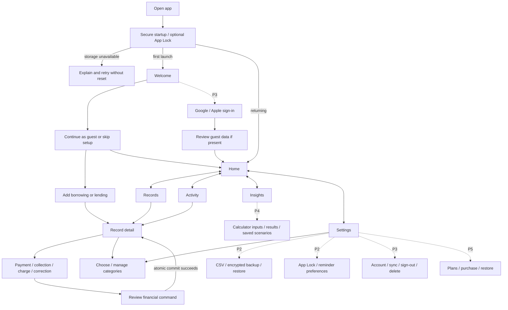
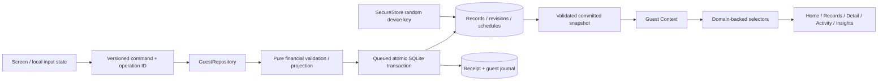

# Nodebt — Master Development Blueprint

> Last reviewed: **29 October 2026 (Asia/Calcutta)**. Financial implementation baseline: **`9ad8333`** on `master`; SDK/CI maintenance is recorded in [GitHub and Expo verification](docs/GITHUB_EXPO_VERIFICATION.md).
> **Current position:** P0 is complete; P1 implementation exists and Android encrypted persistence is verified, but full P1 acceptance is open. P2–P6 are pending. This document does not authorize starting a gated milestone.

## Contents

1. [Purpose, sources and maintenance](#1-purpose-sources-and-maintenance)
2. [Product vision and scope](#2-product-vision-and-scope)
3. [Access tiers and commercial rules](#3-access-tiers-and-commercial-rules)
4. [Financial business rules](#4-financial-business-rules)
5. [Complete application flow](#5-complete-application-flow)
6. [Screen-by-screen specification](#6-screen-by-screen-specification)
7. [Feature and dependency map](#7-feature-and-dependency-map)
8. [Technical architecture](#8-technical-architecture)
9. [Data model and storage](#9-data-model-and-storage)
10. [Cloud, integrations and background work](#10-cloud-integrations-and-background-work)
11. [Development roadmap and task register](#11-development-roadmap-and-task-register)
12. [Testing and quality assurance](#12-testing-and-quality-assurance)
13. [Progress and verification checkpoint](#13-progress-and-verification-checkpoint)
14. [Open decisions, assumptions and risks](#14-open-decisions-assumptions-and-risks)
15. [Android-first delivery and release](#15-android-first-delivery-and-release)
16. [Working practices and next action](#16-working-practices-and-next-action)

## 1. Purpose, sources and maintenance

This is the central index and execution blueprint for designing, building, verifying and launching the complete approved mobile MVP. It consolidates existing requirements without changing financial rules, replacing the engine, or treating future integrations as functional.

### 1.1 Source precedence

When sources disagree, apply this order:

1. Explicit user-approved decisions and corrections in the project conversation.
2. [Approved decisions/readiness](docs/DEVELOPMENT_READINESS.md), including the corrected category and audience requirements.
3. The supplied **“Nodebt App — Product Synopsis”**, which identifies its source as PRD v1.0, 21 October 2026, pages 1–25, including the category update. The attachment was reviewed; the original full PRD/PDF is not present in this repository and was not independently reviewed.
4. [Implementation plan](docs/IMPLEMENTATION_PLAN.md) and [storage design](docs/P1_STORAGE.md) for recorded technical defaults and delivery order.
5. Code, migrations and tests for what actually exists; device/audit reports for what was actually verified. Code does not silently override an approved product requirement.

Supporting records: [README](README.md), [original P1 manifest](docs/P1_VERIFICATION.md), [native setup/checklist](docs/P1_NATIVE_SETUP.md), [Android verification](docs/P1_ANDROID_VERIFICATION.md), and [technical audit](docs/TECHNICAL_AUDIT.md). The outer workspace README is only a repository label; the application and this plan belong in `Nodebt/`.

### 1.2 Status vocabulary

| Status | Meaning |
| --- | --- |
| **COMPLETED** | The named deliverable exists and its stated checks pass. Does not imply broader device/release acceptance. |
| **IN PROGRESS** | Work is implemented or underway, but an acceptance gate remains open. |
| **PENDING** | Required work has not been implemented or verified yet. |
| **BLOCKED** | A named dependency, configuration, platform or decision prevents that particular task from finishing. |
| **DEFERRED** | Explicitly outside the approved MVP; not a synonym for unfinished MVP work. |

“APPROVED” describes requirement agreement; it does not mean implemented. A proposed screen below is an organization of approved functionality, not an approved route name or final visual design.

### 1.3 How to keep this file current

- Update the baseline, date, task status and evidence after each milestone or material decision.
- Use the stable screen/task IDs below in issues and review descriptions. Record a blocker against the specific task rather than stopping unrelated work.
- Attach verification scope: platform, OS, build type, scenario, result and evidence. Preserve older reports as historical evidence.
- Amend approved rules only after an explicit decision; record the prior rule and why it changed. Do not silently resolve a product conflict through code.
- Keep implementation details in the linked design/audit documents; keep delivery status and cross-feature dependencies current here.
- This documentation change does not itself commit, push, deploy, register apps or configure external services.

## 2. Product vision and scope

**Vision:** Know what you owe. Track what you are owed. Find your way to zero.

Nodebt is a private, mobile-first personal borrowing and lending tracker with an optional deterministic repayment-planning layer. Its foundation is accurate records and understandable history; forecasts become useful only after the inputs are trustworthy.

### 2.1 Users and problems

| Audience/problem | Product response |
| --- | --- |
| People with mixed formal loans, credit cards, BNPL and informal borrowing | One private borrowing ledger with explicit types, categories and entered schedules. |
| Friends, families, colleagues and individual lenders | A separate lending direction with collections and outstanding receivables. |
| Salaried professionals, students, young adults and freelancers with scattered records | Simple guest onboarding, current opening balances, quick financial actions and searchable records. |
| People who lose track of partial payments, dates and corrections | Component balances, overdue remainders, transaction revisions and device reminders. |
| People comparing repayment approaches | Pro Snowball/Avalanche and hypothetical Consolidation/Balance Transfer tools with disclosed assumptions. |

These audiences come from the synopsis and later approvals. Relative segment demand, retention and willingness to pay are hypotheses to validate, not established research findings.

### 2.2 Objectives and first value

- Let a new guest enter one genuine outstanding obligation without an account or reconstruction of old payments.
- Show liabilities and receivables independently, with no implication that expected collections are spendable repayment cash.
- Make every balance explainable through valid financial entries and immutable correction history.
- Keep local tracking usable without a backend connection; add reviewed synchronization and recoverability without sacrificing that foundation.
- Make privacy, security and complete export/recovery available to every tier.
- Keep the setup maintainable for a solo designer/developer using AI coding assistance and an initial backend budget of **$0–$25/month**.

The first-value journey is: Welcome → guest → add an outstanding record → see its exact component balance on Detail and Home → record a partial payment/collection → see the correct remaining amount and preserved history.

### 2.3 Approved MVP boundary

**Included in the full commercial MVP:** guest borrowing/lending, interest-free/manual-interest tracking, categories and access rules, payments/collections, schedules, charges/adjustments, corrections/void/restore, forgiveness/write-offs/settlement, closure/archive/reopen, five tabs, local reminders, optional App Lock, CSV, encrypted restorable backups, optional accounts and reviewed guest import, offline sync/conflict handling, account deletion, four Pro calculators and saved scenarios, verified subscriptions/lifetime ad-free, and consent-gated banners.

Android is the first development/test target. Android **and iOS** remain production targets; staged Android delivery does not remove iOS requirements. Initial ledger currency is INR and initial language English. The architecture must remain adaptable globally; this is not a multi-currency or automatic-FX promise.

**Explicitly deferred/excluded:** polished Pro PDF reports, additional currencies/languages, a public web application, bank-data extraction/integration, AI financial advice, loan origination, wallets/payment transfers, shared/counterparty ledgers, contact invitations, automated collection services, email/SMS reminders and automated debt-settlement recommendations. Manual recording of an actual agreed settlement is included. Do not introduce general expense tracking through balance-increase entries.

## 3. Access tiers and commercial rules

| Capability | Free | Pro | Lifetime Ad-Free alone |
| --- | --- | --- | --- |
| Unlimited core borrowing/lending records and history | Yes | Yes | Yes |
| Payments, collections, adjustments, settlement and lifecycle | Yes | Yes | Yes |
| Default borrowing categories available | Exactly 6 | All 16 | Exactly 6 |
| Default lending categories available | Exactly 6 | All 14 | Exactly 6 |
| New custom categories per direction | Up to 3 | Unlimited | Up to 3 |
| Existing categories/assignments retained after Pro expiry | Yes | Yes | Yes |
| App Lock, local reminders, CSV and full encrypted backup/restore | Yes | Yes | Yes |
| Basic factual summaries | Yes | Yes | Yes |
| Four calculators, advanced forecasts, new/recalculated saved scenarios | No | Yes | No |
| View previously saved scenarios after Pro expiry | Yes | Yes | Yes |
| Advertising when configured/consented | Eligible | Removed | Removed |

Pro and Lifetime Ad-Free are independent entitlements; they may coexist. Lifetime Ad-Free never grants Pro calculators or unlimited new categories.

- Approved India target prices recorded in readiness: **₹99/month**, **₹699/year**, **₹1,499 one-time lifetime ad-free**. Display live localized store product prices and renewal terms at purchase time.
- The synopsis also contains ₹399 for lifetime ad-free. That conflicts with ₹1,499 elsewhere and is not adopted here; preserve the later approved readiness value. Reconcile storefront configuration before sale, not by guessing in UI.
- No timed trial. Any sample calculator preview uses conspicuously labelled sample inputs, never persisted guest records or a simulated successful purchase.
- Sign-in is required before purchasing. Guest core tracking stays free and account-optional.
- Expiry never deletes records, custom categories, historical assignments or saved scenarios. Existing custom categories can be reused; creation stops if the Free count is already at/above three in that direction. Archived categories count toward this limit.
- Retain an existing paid-default assignment after downgrade; a new assignment to another paid default requires Pro. Default catalogs are read-only in P1 and versioned for future changes.
- Cached verified Pro remains valid through paid-through expiry; cached verified lifetime ownership remains usable until refreshed. Purchases/restoration require connectivity. Refund/revocation/grace handling must reconcile with verified provider state.
- Banners are confined to quiet Home/Insights placements. No interstitial/rewarded ads or ads on financial forms, recovery/import flows, or while App Lock covers the app. Failure to load an ad must not block tracking.

## 4. Financial business rules

The existing pure domain is the calculation authority. Screens and storage adapters must not implement alternative balance or interest calculations.

| ID | Invariant / required behavior |
| --- | --- |
| FIN-01 | Store integer safe minor units. INR uses paise, scale 2. Reject fractional paise, exponent/ambiguous input and unsafe arithmetic. Decimal strings are parsed deliberately; floats are not stored as money. |
| FIN-02 | Each record has a stable ID, one direction, explicit currency and exactly one opening snapshot at its tracking start. Opening components describe current unpaid principal/interest/fees; no earlier cash history is invented. |
| FIN-03 | Maintain principal, interest and fee components separately. Outstanding derives from current valid revisions; never overwrite a balance column to “fix” it. Each component stays nonnegative after every effective posting. |
| FIN-04 | Additional borrowing/lending/card charges are principal advances. Interest and fees are separate explicit charges. Interest-free records reject interest entries. Categories/types alone never select a financial model. |
| FIN-05 | An EMI/payment settles its entered principal/interest/fee components. When an unrecorded interest/fee charge is needed, review and atomically post that charge with its payment. Do not reduce principal by the entire EMI or infer APR. |
| FIN-06 | Future confirmed cash entries are rejected. Future obligations belong in schedules. Effective/due dates are validated calendar dates; revision timestamps are canonical UTC. A posted entry cannot predate tracking. |
| FIN-07 | One-time and monthly entered schedules are supported; monthly anchors preserve month-end/leap-year behavior. Schedule creation never accrues interest. Existing contracts must not be silently rewritten after payments. |
| FIN-08 | Default allocation is oldest unpaid installment first. A ₹3,000 payment on ₹5,000 due leaves ₹2,000 outstanding/overdue after the due date; future installments retain their amounts. Explicit valid allocations may override FIFO. |
| FIN-09 | Fee payments do not silently satisfy unrelated installments. Default schedule allocation uses principal plus interest; explicit contractual allocations can include fees. Unassigned cash remains visible. |
| FIN-10 | Principal-only prepayment requires the record's terms flag. It reduces principal, not scheduled installments; no silent future-schedule/interest recalculation. Any supported recalculation must be separately reviewed and versioned. |
| FIN-11 | Corrections append revisions under the same entry ID/type, with parent revision, reason and new revision ID. Void/restore preserve old revisions. The opening snapshot cannot be voided. Revalidate the complete ledger/schedule, including later entries. |
| FIN-12 | Stale record versions, incorrect parent revisions, duplicate revision identities and invalid branches fail explicitly. Device-clock ordering never decides which money edit wins. Identical operation retries apply once; changed inputs under the same operation ID conflict. |
| FIN-13 | Signed adjustments record component deltas and a reason. Borrowing forgiveness and lending write-offs are distinct from payments/collections. Wrong-direction waiver types are rejected. |
| FIN-14 | Partial settlement records actual cash and a separate waived amount atomically; both must be positive in the current settlement command and together clear every component. For full cash use payment; for full waiver use forgiveness/write-off. |
| FIN-15 | Paid-off is a financial status; explicit closure requires zero balance. Zero reached through forgiveness, write-off or adjustment is labelled accordingly, not as full cash repayment. Closed records require reopening before financial changes. |
| FIN-16 | Archive changes visibility only. Outstanding archived records remain in portfolio totals. Reopen/unarchive preserve identity and history; historical schedules do not turn waived amounts into cash. |
| FIN-17 | Never net receivables against liabilities or treat expected collections as repayment budget. Actual cash, forgiveness, write-offs and adjustments have separate reporting meanings. Progress starts at the opening snapshot. |
| FIN-18 | Preserve currency, dates, components, categories, allocations and revision chains across persistence/import/export/restore/sync. Unsupported currencies fail explicitly; no relabelling, silent conversion or cross-currency total. |
| FIN-19 | Forecasts are estimates under an explicit versioned model, independent of recorded facts. Unknown/unsupported contract terms cannot silently enter a calculator. Scenario creation never alters real financial entries. |

Current implementation accepts known component opening amounts and manual interest; it does **not** yet have a complete unknown-breakdown reconciliation/forecast-eligibility model. Do not call an unknown aggregate verified principal. The missing contract metadata is tracked in P1-GAP-03/P4-01.

## 5. Complete application flow

### 5.1 Navigation map



Solid paths describe the current guest journey, including forms whose complete device acceptance is still open. Dashed paths are future phases. App Lock is a P2 addition to startup; Google/Apple account flows are P3. Final route names for future screens remain unassigned.

### 5.2 First launch and returning guest

1. Open the native app; initialize secure storage or show an actionable error. Unsupported Expo Go/web never opens a plaintext ledger.
2. First launch shows Welcome with the local-data/recovery limitation. Continue marks onboarding saved and opens Add Record; skip marks it saved and opens Home.
3. Choose direction, type, category and known opening components; optionally enter person, schedule and permitted prepayment terms.
4. Validate and atomically commit the opening, metadata, schedule, receipt and local journal. Only then show the new Detail screen and updated Home totals.
5. Returning users open Home after initialization and, once enabled in P2, device authentication. Onboarding is not replayed after restart.

### 5.3 Tracking and correcting money

1. Home/Records/Activity → record detail → relevant financial action.
2. Enter actual components/date; optionally recognize explicit new charges and specify installment allocations. Required reason applies to adjustment, waiver, settlement and correction.
3. Review cash, charges, waivers and allocation separately → confirm → repository validates engine projections and commits atomically.
4. On success, return to the same record; all views derive the new balances/history. On failure, retain inputs and explain why nothing was confirmed. Retry uses the same operation identity for the same reviewed command.
5. History → current entry → correction/void/restoration → review → new revision. A correction invalidating a later payment/allocation is rejected; the UI must guide the user to review dependent entries rather than hide them.
6. Repay/collect/settle to zero → financially appropriate status → explicit close confirmation. Archive is independent. Reopen the same record before further financial entries.

### 5.4 Account onboarding and guest import — P3

1. Choose Google/Apple from Welcome or Settings; cancel/failure returns safely to the existing guest context.
2. Complete OAuth and load the signed-in owner's cloud state in its own local scope. Explicit identity linking must not merge users solely by an editable email/name claim.
3. If guest data exists, show it alongside existing cloud records; flag likely duplicates for review.
4. Select records to import or skip. Do not automatically merge or overwrite financial records. Import every selected record with its complete related history, categories, dates, allocations and financial metadata.
5. Destination commit/acknowledgement → verify → show success. Retain the source guest data until verified. Cancellation, failure or skipped import leaves it recoverable and isolated; it does not become the account's active ledger automatically.
6. A brand-new account has an empty cloud ledger unless an explicitly selected import succeeds. Returning accounts preserve their existing records before and after import.

### 5.5 Recovery, planning and commerce — later MVP phases

- **Backup:** Settings → Backup → password + confirmation + no-recovery warning → encrypted creation → user saves/shares file. Wrong/missing passwords cannot be reset by Nodebt.
- **Restore:** select file → bounded format checks → password/authentication → compatibility/domain checks → duplicate/conflict review → explicit confirmation → atomic import → verify success. Failure changes neither source nor destination.
- **Reminder:** Detail/due item → reminder settings → contextual permission request → local scheduling. Denial leaves tracking usable. Changes reschedule only after verified financial/schedule commits.
- **Planner:** Insights → eligible borrowing selection → model/inputs and total budget → validate minimums/terms → calculate estimate → results/schedule/assumptions → optionally save immutable scenario. Source changes mark it stale.
- **Purchase:** Settings/locked premium action → plans → sign-in if needed → verified store purchase → entitlement reconciliation → return to initiating action. Cancellation never grants access. Restore/manage subscriptions remain discoverable.
- **Sign Out:** Settings → inspect unsynced work → sync or cancel/explicit safe retention path → switch local scope only after ensuring changes are not silently discarded. Exact retention UX is an open implementation decision.
- **Delete Account:** Settings → export opportunity → consequences and explicit confirmation → online server deletion/replay protection → clear current account's local data. Offline devices cannot be remotely wiped immediately; on reconnect they must be rejected and reconciled without resurrecting records.

## 6. Screen-by-screen specification

### 6.1 Rules shared by all screens

Use safe areas, a consistent Page/Card/Field/Button/Problem vocabulary, system light/dark mode, readable text scaling, labelled controls and adequate touch targets. Financial forms use the repository/domain, never SQL or parallel arithmetic. Preserve meaningful loading, empty, permission-denied, retry, invalid-ID and storage-failure states. Disable duplicate submissions while committing, and show success only after acknowledgement. Use current labels/direction consistently; never imply unavailable cloud backup, purchases or reminders are active.

All proposed screens must expose a return/cancel route. Deep links must validate identity/scope and avoid exposing a record before authentication/App Lock. Future screens can be grouped as sheets/steps; their feature behavior is required, not an invented number of standalone routes.

### 6.2 Implemented route inventory

| Screen | Route / source | Actual implementation and remaining scope |
| --- | --- | --- |
| S01 Startup/index | `src/app/_layout.tsx`, `src/app/index.tsx`, `src/features/guest/provider.tsx` | Encrypted initialization, loading/error/retry, redirect by onboarding. Optional lock and account scope are pending. |
| S02 Welcome | `src/app/welcome.tsx` | Guest continue/add and skip/Home. Sign-in is explanatory text, not a working button. |
| S03 Home | `src/app/(tabs)/home.tsx` | Separate totals, add actions, due/overdue list and recent visible records. No ad integration. |
| S04 Records | `src/app/(tabs)/records.tsx` | Search title/person/category text, direction selection and include-archived toggle. Dedicated category/status filters and general editing are not implemented. |
| S05 Add record | `src/app/record/new.tsx` | Borrow/lend, opening components, manual-interest mode, type/category and entered schedule. No APR contract engine. |
| S06 Record detail | `src/app/record/[id]/index.tsx` | Component balances, actions, schedule, history, category and lifecycle. No general metadata/schedule editor or reminders. |
| S07 Entry/review | `src/app/record/[id]/entry.tsx` | Shared financial action/correction form and review state; atomic repository commands. |
| S08 Categories | `src/app/categories.tsx` | Direction catalogs/custom management and record assignment. Free policy active; Pro only tested through isolated services. |
| S09 Activity | `src/app/(tabs)/activity.tsx`, `src/features/guest/activity-list.tsx` | All revisions and history links. Calendar/due/reminder presentation from the synopsis remains pending. |
| S10 Insights | `src/app/(tabs)/insights.tsx` | Factual outstanding/cash summaries. No advanced reports/calculators/exports yet. |
| S11 Settings | `src/app/(tabs)/settings.tsx` | Category link, INR and explicit availability/recovery information. Account, privacy, backup and commerce controls pending. |

### S01 — Startup, loading and secure-storage failure

- **Purpose/components:** initialize the native encrypted guest repository before any financial screen; loading indicator, preserved-data explanation and retry action.
- **Navigation/actions:** unopened ledger → loading → Welcome/Home; failure → retry. Current index uses persisted `onboardingComplete`.
- **Validation/edges:** reject Expo Go/web, unavailable SecureStore, missing key for existing DB, invalid key, absent SQLCipher, integrity/migration/newer-schema errors. Never reset, recreate or downgrade user data as recovery. P2 adds App Lock; P3 adds account-scoped selection without opening another owner's ledger.

### S02 — Welcome and guest onboarding

- **Purpose/components:** concise value proposition, formal/informal borrowing/lending examples, encrypted device-local limitations, continue and skip buttons.
- **Actions/navigation:** Continue → save onboarding → S05; Skip → save onboarding → S03. P3 adds optional Google/Apple entry without making guest tracking depend on it.
- **Validation/edges:** failed onboarding commit leaves a retryable error; no false success/seeded financial records. Back/cancel must not erase an existing ledger. Recovery messaging must accurately reflect the installed milestone.

### S03 — Home

- **Purpose/components:** separate owed/receivable cards, quick add buttons, upcoming/overdue rows and record cards. Existing due list is limited to six; visible record cards to four.
- **Actions/navigation:** add direction → S05; due/record → S06; bottom navigation → S04/S09/S10/S11.
- **Validation/edges:** archived outstanding amounts remain in totals while archived records are omitted from the current quick lists. Empty state invites first record; waived amounts never increase repayment progress. Current “recent records” list is not guaranteed created-time ordering because the snapshot loads by ID; verify intended ordering before describing it as chronological activity. Recent transaction activity from the synopsis needs an explicit Home presentation task. P5 may add consent-gated banners.

### S04 — Records list/search

- **Purpose/components:** searchable record cards, All/I owe/Owed to me, include archived, add button; proposed dedicated category/status filters complete the planned management surface.
- **Actions/navigation:** search/filter → matching cards → S06; Add → S05; clear filters returns the full relevant scope.
- **Validation/edges:** distinguish no records from no matches, preserve original category labels/assignments, handle closed/archived combinations, scope to the active guest/account. Do not report a status/category picker as implemented merely because text search matches category names.

### S05 — Add Money I Owe / Add Money Owed to Me

- **Purpose/components:** direction; title; optional person/institution label; Loan/Credit card/BNPL/Informal/Other type; available categories; known outstanding principal, optional unpaid interest/fees; tracking start; interest-free toggle; permitted principal-only-prepayment toggle; none/one-time/monthly schedule with first date, amount and count.
- **Actions/navigation:** direction resets the selected category to that direction's available default; manage categories → S08; Save → atomic create → S06; Back → previous route/Home.
- **Validation/edges:** trimmed title 1–120 characters; optional person ≤120; allowed same-direction category; exact nonnegative amounts; nonzero opening; no interest under interest-free mode; real dates; opening not in future; schedule due not before tracking; positive schedule amount and 1–600 installments. Principal is a required amount field; zero is valid when another positive component makes the opening nonzero. Do not force an APR for informal/interest-free records or treat unknown totals as principal. Cancellation/draft retention needs device QA; no persistent draft feature is currently promised.

### S06 — Borrowing/lending record detail and lifecycle

- **Purpose/components:** direction/status/archive label; outstanding and component balances; category/person/type/tracking date; actual cash versus forgiveness/write-off; scheduled versus paid/unpaid amounts; full transaction/revision history and metadata events.
- **Actions/navigation:** repay/collect, advance, charge, adjustment, waiver or settlement → S07; recategorize → S08; close/archive/reopen → inline confirmation. A general metadata/terms/schedule editor is a pending gap, not an existing route.
- **Validation/edges:** missing ID/current-owner record gives not-found; close disabled above zero; closed record cannot post until reopened; confirmation captures expected version. An archived debt still contributes to totals. Historical unpaid schedule residue after settlement is labelled as historical unpaid/waived outcome, not a late cash obligation. Interest-charge action appears only for manual-interest records.

### S07 — Financial entry, correction and review

- **Purpose/components:** component inputs, date, note/reason, current balances, optional explicit charges, principal-only mode, FIFO/exact installment allocation, settlement cash/waived inputs, and a separate review/confirm state.
- **Variants:** repayment/collection; additional principal/card charge; interest/fee; signed adjustment; borrowing forgiveness/lending write-off; partial settlement; correct/void/restore including opening correction under its fixed date/identity rules.
- **Actions/navigation:** review → confirm/save → same S06; edit inputs returns to form; current history entry launches its correction variant. Prior revisions remain readable.
- **Validation/edges:** FIN rules apply to the full resulting history, not just the edited amount. Required reasons, forbidden components, overpayments, unsupported prepayment, invalid/foreign/overpaid allocation and stale versions reject the command. Settlement cash/waiver are separate entries in one commit. New charges plus payment commit together. Correcting a charge/payment can invalidate later entries and must return a useful error. No type-changing correction or voided opening. Verify retry after editing failed input uses the right new operation identity; stable retry IDs must not strand a corrected form under an already committed request.

### S08 — Category selection and management

- **Purpose/components:** borrowing/lending directions, available defaults, custom count/list, new-name input, rename/archive controls and record assignment actions.
- **Actions/navigation:** Settings/S05/S06 → manage/select; create or rename → save; assign → expected record version → return. Default labels are not editable in P1.
- **Validation/edges:** 1–60 trimmed characters; case-insensitive unique name within direction; same label can exist in another direction; three customs per direction for Free including archived/retained Pro. Archive retains references and prevents new assignment except keeping an existing one. Rename/reuse are allowed after expiry. Guard missing record, stale version, category direction and unavailable paid defaults. P5 connects verified entitlements without local unlock toggles.

### S09 — Activity and history

- **Purpose/components:** current/superseded/void labels, effective and recorded dates, component amounts, reason, record links and correct/restore actions.
- **Actions/navigation:** global row → S06; current editable revision → S07. Record detail reuses the same history component.
- **Validation/edges:** no-history empty state, preserved older revisions, closed-record action restrictions. Current global ordering uses recorded timestamp, revision and ID for display only; it must not decide financial conflict resolution. The synopsis mentions calendars/overdue/reminders: integrate a date-oriented due view with S14 and record navigation in a later MVP task; a specific calendar-widget design is not approved yet.

### S10 — Insights and reports hub

- **Purpose/components:** independent outstanding borrowing/lending and actual cash totals since tracking started. Planned: basic progress/report presentation, exports link, Pro calculator cards, saved scenarios and gated banner area.
- **Actions/navigation:** factual report → relevant records; export → S15; calculator → S20–S24; locked capability → S25; saved scenario → S24.
- **Validation/edges:** no invented pre-tracking progress, no waivers as cash and no netted receivables. Empty/incomplete data yields explanations, not fabricated charts or payoff dates. Charts/report layouts beyond current totals need design; polished PDF reports stay deferred.

### S11 — Settings hub

- **Purpose/components:** guest/account state, categories, currency/language availability, privacy/security, reminders, data/recovery, plans/purchases and account lifecycle.
- **Actions/navigation:** current category link → S08; proposed feature entries → S12–S19/S25. Sign Out and Delete Account remain separate actions.
- **Validation/edges:** current guest-only version must keep accurate “not available yet” explanations. No currency relabelling; no paid gate on security/recovery; disable network-required operations with a recovery path rather than losing offline work. Help/privacy disclosures must be reachable before public launch; exact presentation is pending.

### 6.3 Planned MVP screens and connected states

All rows below are **PENDING**. Their names/grouping are proposed navigation structure for already-approved features; no file route or backend endpoint is claimed implemented.

| ID / phase | Purpose and UI | Actions/navigation | Validation, failure and edge behavior |
| --- | --- | --- | --- |
| S12 Privacy & Security / App Lock — P2 | Enable switch, device-auth availability, immediate/30s/1m timeout, privacy-overlay behavior. | S11 → enable with native auth; lock gate on cold open/resume; cancel stays locked. | Disabled by default, all tiers; biometrics/device passcode when available; no separate Nodebt PIN required. Explain missing device security; verify enrollment changes and auth cancellation without revealing financial screens. |
| S13 App authentication gate — P2 | Generic locked view and unlock/retry action. | Opening/resume/deep link → device auth → intended screen. | Conceal sensitive UI/app-switcher preview; app lock is separate from database encryption and account sign-in. No ad or financial content before unlock. |
| S14 Reminder preferences / due view — P2 | Due/collection date context, time (default 9 a.m. local), generic/detailed content opt-in, permission status. Activity date view links to the relevant record. | S06/S09/S11 → configure → permission in context → schedule; denied → OS settings guidance. | Permission not required for tracking; generic lock-screen copy by default. Reconcile edits, timezone/resume, payment/closure and OS scheduling limits. Calendar presentation depth is an open design detail, not an implemented feature. |
| S15 Export/data hub — P2 | Choose CSV bundle or full encrypted backup; plaintext CSV sensitivity notice. | S11/S10 or pre-deletion export → S16/CSV save-share → explicit completion. | All tiers; CSV contains linked records/revisions/categories/schedules and readable/minor-unit values. Escape spreadsheet formulas; cancellation/storage failure must not claim a saved file. CSV is not the complete restore format. |
| S16 Encrypted backup creation — P2 | Password, confirmation, no-recovery warning, secure-storage instructions, progress/result. | S15 → validate → create/authenticated encryption → save/share. | Complete financial metadata/history/settings; random salt/nonce; bounded work. Never log/store password, include device key/session tokens, or trust restored billing flags. No forgotten-password reset/backdoor. |
| S17 Restore validation/review — P2 | File selection, password, validation progress, record/category/revision duplicate/conflict preview and explicit confirmation. | S15 → inspect/decrypt/validate → review → atomic import → verification summary. | Wrong password, tampering, truncation, oversized/future-version/unsupported-currency files fail safely. Never auto-overwrite or partially import financial history; cancel retains both datasets. |
| S18 Sign-in / identity linking — P3 | Google/Apple choices, pending/cancel/error states, account identity context. | S02/S11/S25 → OAuth → S19 if guest data exists, otherwise active account Home; explicit identity linking from Account. | No unapproved email/password method. Validate callback/session, cancellation, expired session and linked-provider collisions. Optional sign-in never destroys guest data. |
| S19 Guest review/import — P3 | Existing cloud records separate from selectable guest records, possible-duplicate indicators and skip/import summary. | S18 → choose → confirm → acknowledged import/verify → Home. | Preserve full related histories/components/dates/currency; retry by import IDs, no automatic financial merge. Source remains intact until verified; skip keeps source recoverable in isolation. |
| S20 Snowball / Avalanche input — P4 | Eligible borrowing selection, supported terms/minimums, total monthly budget, assumptions and strategy choice. | S10 → validate → S23 comparison; insufficient terms → reconcile record or exclude explicitly. | Minimums reserved first; receivables excluded; insufficient budget/non-amortizing debt shown clearly. Exact model/rounding must be versioned and independently tested. |
| S21 Consolidation input — P4 | Selected current debts, replacement APR, term/payment and upfront/capitalized fees. | S10 → compare baseline/replacement → S23. | Hypothetical only; reject missing/inconsistent terms, model all disclosed fees and no lender-approval promise. Never creates a real consolidation record automatically. |
| S22 Balance Transfer input — P4 | Eligible transferred amount, transfer fee, promo duration/APR, later APR and scenario payment inputs. | S10 → calculate → S23. | Bound amount/promo horizon; explicit transition behavior/rounding; unsupported remaining-balance treatment requires a defined model, not a guessed forecast. |
| S23 Forecast results/comparison — P4 | Payoff horizon, interest, monthly schedule, assumptions, limitations and save action. | S20–S22 → inspect/edit inputs/save → S24. | Non-amortizing/insufficient-budget plans show no false payoff date. One-paisa residuals remain visible. Results never post to ledger. |
| S24 Saved scenarios/history — P4 | Immutable inputs/results, model/date, source links and stale label. | S10/S23 → list/detail; Pro may create/recalculate; expired users may view. | Source corrections mark saved results stale. Original snapshot retained; recalculation creates a new result. No use of stored entitlement flags as authority. |
| S25 Plans, purchase, restore/manage — P5 | Pro monthly/annual, distinct lifetime ad-free, localized prices, renewal/cancellation terms and restore/manage actions. | S11 or locked feature → S18 if guest → store sheet → verify → originating feature. | Cancellation/failure gives no access; duplicate webhooks/retries apply once; test restore/device switch/grace/refund/expiry and independent lifetime ownership. |
| S26 Account / sync status / conflict review — P3 | Active identity, pending/synced/needs-attention state, actionable conflicts with preserved branches, sign-out entry. | S11/status indicator → inspect/retry/catch-up; select explicit correction resolution → verified state. | No last-write-wins; flag affected totals. Separate account caches, retry expired sessions safely, never drop pending commands. Exact conflict UX/protocol is a design task. |
| S27 Sign Out confirmation — P3 | Unsynced-change summary and safe next actions. | S26 → sync then sign out, or cancel; an explicit encrypted-retention path needs design before use. | No silent discard, cross-owner cache exposure or presenting a local sign-out as cloud deletion. |
| S28 Delete Account — P3 | Export opportunity, explicit irreversible confirmation, data/backup-retention and store-subscription explanation. | S26 → optional S15 → online deletion → current-account local cleanup → signed-out/guest entry. | Server blocks replay/writes from old sessions/devices; cloud data removed per approved scope. Retained provider backups/legal/purchase metadata disclosed accurately. Never imply account deletion cancels a store subscription. |
| S29 Record metadata/terms/schedule review — pending gap | Existing metadata plus a reviewed proposed schedule/term change and its historical effect. | S06 → edit allowed metadata/terms → validate dependency effects → confirm versioned command → S06. | No general editor exists today. Decide editable fields, direction/currency immutability, unknown-breakdown representation and schedule revision rules before implementing this boundary. Existing allocations/history must survive; reminders reschedule after commit. |
| S30 Privacy/about/help disclosures — P6 | Reachable privacy policy, data/recovery/retention explanations, app/build information and support route. | S11 and relevant consent/account/purchase flows → disclosure → return. | Required disclosures must match actual SDKs, retention and enabled permissions; URLs, support channel and legal text are not configured. No fabricated certification/compliance claim. |

## 7. Feature and dependency map

| Feature | Status / dependency | Expected behavior and completion boundary |
| --- | --- | --- |
| Deterministic financial domain | COMPLETED — P0 | Exact components, revisions, schedules and portfolio separation; original 30 tests retained. Extend only for a documented supported rule. |
| Encrypted guest persistence | COMPLETED implementation; Android scoped native tests pass | Versioned schema, device key, atomic writes, fail-closed opening and operation receipts. Remaining full platform acceptance belongs to P1. |
| Guest tracking screens | IN PROGRESS — P1 | Current routes are wired; full save/edit/keyboard/accessibility/offline device journeys still required. |
| Categories | COMPLETED core policy; P5 entitlement wiring pending | Exact 6/6 Free and 16/14 Pro catalogs, 3 customs per direction for Free, preserve expired-Pro history; default names are launch labels. |
| Record/schedule editing and reconciliation | PENDING gap — P1 review/P4 eligibility | Versioned metadata and supported schedule edits, no silent reinterpretation of existing money. Define unknown component handling before planner admission. |
| Local reminders and date-oriented activity | PENDING — P2, committed schedules | Device-only scheduling, generic default content, permission management, change reconciliation and settled/closed suppression. |
| Optional App Lock | PENDING — P2, native device auth | Free, disabled initially, cold-open/resume gate with configurable timeout and privacy overlay. Does not replace SQLCipher. |
| CSV | PENDING — P2, validated snapshot | Linked exports include transactions/revisions, categories, dates, currency/scale and component breakdowns. Plaintext sensitivity and formula escaping. |
| Complete encrypted backup/restore | PENDING — P2, reviewed crypto/format | Full portable financial history with validation/review/atomic restore. No password recovery; source/destination remain intact on failure. |
| Accounts and isolated local scopes | PENDING — P3; provider/identity setup BLOCKED | Google/Apple, explicit linking, separate guest/account caches and optional sign-in. No cloud owner in current guest schema. |
| Cloud catch-up and conflict resolution | PENDING — P3, server command protocol | Persistent outbox/cursors/acknowledgements, retries, branch review and deletion tombstones; offline committed work retained. |
| Guest review/import | PENDING — P3 after account/sync contracts | Record selection, duplicate review, verified complete destination import and retained guest source. No financial auto-merge. |
| Sign Out / Delete Account | PENDING — P3, sync/deletion protocol | Protect pending edits; export opportunity; clear current account data; reject resurrection by old devices. |
| Basic summaries/progress reports | IN PROGRESS | Existing exact totals/cash facts; remaining report/date/filter UX must be specified without invented historical progress. |
| Four Pro tools and saved scenarios | PENDING — P4 after trustworthy inputs/models | Eligible borrowing only, explicit budget/minimums/fees/promo rules, immutable estimates and stale markers. |
| Pro/lifetime commerce | PENDING — P5; store/provider configuration BLOCKED | Store-verified independent entitlements, safe offline cache, restore/expiry/refund reconciliation, no local success toggle. |
| AdMob banners | PENDING — P5; consent/app configuration BLOCKED | Test-only until validated, limited placements, suppress for paid ad-free access, core unaffected by failures. |
| Operational monitoring/release | PENDING — P6; provider choice open | Redacted failures/timings, quota alerts, controlled testing and recovery drills. CI source checks exist; production telemetry does not. |

## 8. Technical architecture

### 8.1 Existing stack versus planned services

Versions below describe the reviewed baseline, not a recommendation to install newer packages. Recheck the matching Expo documentation and `expo install --check` before any future native dependency change; preserve the lockfile.

| Layer | Actual baseline / target |
| --- | --- |
| Runtime/tooling | Node 24.22.0, npm 11.19.1; Windows PowerShell uses `.cmd` launchers without relaxing script policy. |
| Mobile | Expo **58.0.21**, React Native **0.88.1**, React **19.3.0**, TypeScript **6.0.3**; strict TypeScript remains enabled. |
| Navigation/UI | Expo Router **58.0.28**, React Navigation theme, SafeAreaProvider, reusable native UI; no new design-system dependency required. |
| Local storage | Expo SQLite **58.0.14** compiled with SQLCipher; SecureStore **58.0.2**, Crypto **58.0.7**, FileSystem **58.0.13**. |
| Native development | expo-dev-client **58.0.17**, CNG configuration; Windows-only CMake **3.31.6** via expo-build-properties **58.0.11**. |
| Existing state | React Context + committed GuestSnapshot; local form state; pure domain-backed selectors. No Zustand/Redux/query-cache dependency is required by this plan. |
| Backend — planned | Supabase Auth/Postgres/Edge Functions with RLS and scoped financial commands; not installed/configured in current app. |
| Commerce/ads — planned | RevenueCat and AdMob; not installed/enabled. |
| Reminders/lock — planned | Expo Notifications and device authentication; install exact SDK-compatible packages when implementing P2. |
| Analytics/error monitoring | No provider chosen or integrated. Product analytics optional; baseline operational reporting budget-limited and financially redacted. |

There is no custom application Metro/Babel configuration to replace. Existing SDK-supported defaults, React Compiler and the deterministic SDK-guarded route-type generator remain. No framework migration is part of this blueprint.

### 8.2 Code organization and boundaries

```text
Nodebt/
  PLAN.md                     # Central scope/status/roadmap reference
  src/app/                    # Expo Router screens and layouts only
  src/components/nodebt/      # Reusable mobile UI and record cards
  src/config/product.ts       # Explicit initial market/currency/locale
  src/domain/                 # Money, dates, ledger, installments, categories
  src/features/guest/         # Provider, form parsing, selectors, history UI
  src/storage/                # Secure opener, migrations, SQL adapter/repository
  src/hooks/, src/constants/  # Existing theme/platform helpers
  src/legacy/                 # Preserved starter references, outside routes
  tests/                     # Domain, real-SQLite and security-boundary tests
  scripts/                   # Checked route-type generation and existing scripts
  docs/                      # Decisions, detailed designs and verification evidence
  .github/workflows/          # Source-check CI
  app.json, app.config.ts     # Native behavior/config plugins and identities
  eas.json                   # Existing development profiles only
```

Future auth/sync/backup/billing/calculation modules belong outside `src/app`, following feature/domain/integration boundaries. Their exact directory names are not requirements. Generated `android/` and `ios/` remain ignored CNG output, not manually edited source. `.expo/`, test probes, financial files, secrets and native build output must not be committed.

### 8.3 Current local command/data flow



- The provider opens storage before exposing screens and serializes submissions with a busy guard. Financial views update only from the committed result, not optimistic invented balances.
- `useOperationId` retains a stable ID across a failed retry; receipts compare a canonical request. Expected record/parent versions prevent stale writes.
- Repository re-reads/validates the snapshot inside each command, runs domain rules, inserts only new revisions and writes metadata/event/receipt/journal together.
- `LocalDatabase` queues work on one dedicated keyed connection with `BEGIN IMMEDIATE`/commit/rollback. Failed rollback poisons the wrapper until restart.
- Local date refreshes on foreground and periodically for overdue presentation. It is not an interest-accrual job.
- Snapshot-wide loading, projection, rendering and validation are adequate only to the measured current scale. Larger histories require profiling, indexing, bounded queries/read models and possibly list virtualization; never weaken validation or make cached balances authoritative to improve speed.

### 8.4 Security model

- Persist a random 32-byte device key in SecureStore with device-only/unlocked accessibility and verified readback. Never regenerate a missing key for an existing DB.
- Confirm SQLCipher capability, set validated key, read keyed schema and run integrity checks before migrations; preserve foreign keys, encrypted WAL, busy timeout and FULL synchronous commits.
- Normalize the native SQLite directory to a file URI only for FileSystem checks; do not relocate/reset the database to resolve path errors.
- Fail closed on absent encryption, corruption, key loss and incompatible schema. Browser financial storage and plaintext native fallbacks remain forbidden. SQLCipher requires a native build; [Expo documents its Expo Go limitation and capability check](https://docs.expo.dev/versions/v58.0.0/sdk/sqlite/#sqlcipher).
- Database encryption, optional app authentication, portable password-encrypted backups and server authorization are separate boundaries. The planned cloud design does not establish end-to-end encryption against the backend; do not advertise such a guarantee.
- No names, amounts, notes, raw imports, backup passwords, tokens, keys or financial screen recordings in monitoring. Keep support diagnostics to sanitized codes, counts/timings and build metadata.
- Parameterize user-data statements; no service-role/server secret in a mobile bundle. Explain recovery limitations accurately and never use hidden recovery keys.

## 9. Data model and storage

### 9.1 Current domain entities

| Entity | Key fields / relationships | Required invariants |
| --- | --- | --- |
| GuestRecord / DebtRecord | `id`, title, `borrowed`/`lent`, currency, scale, categoryId, counterparty label, kind, interestMode, trackingStartedOn, createdAt, version, archived, optional closedOn, prepayment flag | Stable identity; category direction matches; INR/scale 2 accepted now; record version increases on changes. Counterparty is private text, not a linked contact/user. |
| Financial entry revision | Stable `id` (entry), unique `revisionId`, recordId, kind, three components, effectiveOn, recordedAt, revision number, optional previousRevisionId/reason/paymentMode/allocations, posted/void state | Complete ordered parent chain; one opening; type unchanged across correction; full ledger validates. Superseded/void entries retained. |
| Installment | id, recordId, dueOn, amountMinor | Separate from charges; derived paid/remaining/status, not authoritative mutable balance. Current entered schedule has no edit/revision command. |
| InstallmentAllocation | installmentId, amountMinor attached to payment revision | Positive, unique targets within record, cash/target limits, preserved on correction/export. Absent means FIFO. |
| Category | id, direction, name, default/custom kind, freeDefault, archived, sortOrder | 30 stable defaults; direction-scoped uniqueness, Free custom cap, retained assignments. |
| RecordEvent | id, recordId, kind, recordedAt, record version and full metadata snapshot | Lifecycle/category/financial-command metadata trail; preserves original record identity. |
| GuestSnapshot | records, revisions, installments, categories, recordEvents, onboardingComplete | Validated read state; not an external backup schema or server contract. |

Financial amounts and currency metadata must remain explicit across all later schemas. Current `Currency` is restricted to INR and formatting/parsing is INR-specific; “globally adaptable” means extending it deliberately, not claiming multi-currency support already exists.

### 9.2 SQLite schema v1 — implemented

| Table | Current storage/constraints |
| --- | --- |
| `categories` | Primary ID, direction/kind/name/archive columns, validated JSON payload; unique index on direction + lower(name). |
| `records` | Primary ID, direction/currency/scale/category/version, payload; category foreign key. |
| `revisions` | Revision ID primary key, record/entry/revision number, parent foreign key, payload; unique record/entry/revision number; UPDATE-blocking trigger. |
| `installments` | Primary ID, record foreign key and payload. |
| `record_events` | Primary ID, record foreign key and full event payload. |
| `settings` | Key + JSON; currently guest onboarding completion. Future settings are not already persisted. |
| `operations` | Stable operation ID, canonical request, committed result and recorded timestamp. |
| `outbox` | Operation foreign key, guest-only scope and versioned command envelope with currency/scale. **A local journal, not functioning cloud synchronization.** |

Schema version is `PRAGMA user_version`. Sequential DDL, catalog seeding and version update occur in one migration transaction. Catalog additions/label changes require a versioned migration, not silent modification of seed constants under existing users. Invalid/newer/incomplete migration histories fail without reset/downgrade. Revisions are append-only in normal financial operations; eventual confirmed account deletion is a separate privileged lifecycle, not a correction mechanism.

### 9.3 Planned entities and migrations — not implemented

| Area | Additional conceptual data | Design gate |
| --- | --- | --- |
| Terms/reconciliation | Known/unknown breakdown status, supported calculation model/version, validated APR/minimum/term inputs and reviewed schedule versions | Define allowed models and edit effects before schema/command changes; do not infer lender rules. |
| Privacy/reminders | App Lock preference/timeout; per-record reminder preferences, generic/detail choice and local scheduling identifiers | Device-local enrollments/permissions require consent; backups cannot grant OS permissions. |
| Backup/import | Versioned file header/manifest; model/schema metadata; reviewed restore/import session/IDs and outcomes | Bound sizes/work; authenticated encryption; complete validation and atomic commit. |
| Accounts/cloud | Owner identity on financial data, isolated local account scope, device membership, stable operation IDs, server acknowledgements/cursors, conflicts and deletion markers | v1 guest journal is not an account outbox. Add versioned migration and authenticated command protocol before sending anything. |
| Scenarios | Immutable input/result snapshot, selected source IDs/versions, model version, calculation date, stale status | Estimates must never become ledger entries. |
| Entitlements | Verified provider/customer mapping and product/expiry/revocation state; safe cached access | Billing provider/store is authority, not restored DB flags or editable metadata. |

Exact Postgres table names, RPC signatures, indexes and file format bytes are implementation decisions to specify and test at their milestone. This blueprint does not pretend those migrations/API contracts exist.

## 10. Cloud, integrations and background work

### 10.1 Backend responsibilities — P3

Supabase is the recorded managed-backend direction: Auth for Google/Apple identity, Postgres for canonical synchronized records, and scoped server operations/Edge Functions for privileged workflows. No always-on custom API server, separate paid sync vendor or premature global replication is planned. Start with an India-near region and validate residency/availability before provisioning.

All exposed owner tables need RLS and appropriate grants. Owner identity comes from verified auth, never an editable request field/user metadata. Test SELECT and mutation ownership, including attempted owner reassignment. Privileged secrets remain server-side. Authorization must not depend on stale claims for deletion/revocation-sensitive writes; define server-side session/account-state checks. These boundaries follow the approved architecture and [Supabase's RLS guidance](https://supabase.com/docs/guides/database/postgres/row-level-security).

Recheck [Supabase's changelog](https://supabase.com/changelog) and exact selected client/CLI docs before implementation. The architecture is approved; a particular Supabase SDK/CLI version has not been selected or installed. Backend grants, policy tests, migrations, OAuth redirects and authenticated mobile session storage remain tasks, not current capabilities.

### 10.2 Logical API contracts to define

| Contract | Required behavior | Not yet fixed |
| --- | --- | --- |
| Auth/callback/link | Verified session, explicit provider linking, cancellation/error handling and account context | Exact SDK flow, callback allowlist and production app identity. |
| Financial command push | Stable operation ID, expected record/parent revisions, deterministic validation, atomic complete acknowledgement | Wire schema, server shared-domain packaging, batching and limits. Direct arbitrary table writes must not bypass rules. |
| Catch-up pull | Owner-scoped incremental state/revisions/tombstones with durable cursor | Cursor design, pagination and catch-up limits. |
| Conflict resolution | Preserve proposed branches; explicit resolution yields valid current state and updates affected totals | Server branch representation and user comparison UI. Current local engine rejects branches; it is not already a multi-device conflict store. |
| Guest/backup import | Stable import identity, selected complete record histories, duplicate review and verifiable commit | Cross-file/account ID collisions and “keep both” remapping rules. Never silently overwrite. |
| Account deletion | Validate account/session, block writes/replay, purge active records/current device and disclose retained exceptions | Tombstone retention, provider backup expiry, legal/purchase metadata and inactive-device reconciliation policy. |
| Billing webhook | Authenticate delivery, verify event, deduplicate/reconcile entitlements/refunds | Store/RevenueCat products and event schema/configuration. |

### 10.3 State, caching and conflicts

- For a guest, the committed encrypted local ledger is the source of truth. For synchronized accounts, the server is canonical for acknowledged shared state, while local committed commands remain available offline until acknowledged.
- A signed-in screen must distinguish pending local state from confirmed sync and needs-attention conflicts. Never silently replace local money with an older server snapshot or hide a rejected command as “synced.”
- Distinct valid new payments may coexist; conflicting revisions sharing a parent require explicit resolution, not last-write-wins. Revalidate balances and allocations server-side; concurrent valid-looking payments may jointly overdraw a component.
- Catch up after reconnect/foreground using persisted cursors. Realtime, if used, is only a refresh signal. Financial correctness cannot depend on receiving every realtime event.
- Isolate guest and each account's database/cache/key ownership. Signing into another account must not expose the previous account or auto-import the guest journal.
- A deletion gate must reject writes even from a still-unexpired old token. Old offline devices cannot upload deleted financial history into the deleted identity when they reconnect.

### 10.4 Async jobs and failure behavior

| Work / trigger | Reliability rule | User-visible outcome |
| --- | --- | --- |
| Local financial save / confirm | Queued transaction + stable operation receipt; no partial money/history/journal commit | Saving → committed result or actionable retry; same request retries once. |
| Reminder scheduling / verified change, timezone/resume | Rolling OS-supported window; cancel/reconcile stale requests; retry on foreground | Permission/scheduling state visible; no guarantee of exact delivery beyond OS support. No remote push dependency. |
| Backup creation / explicit request | Bounded parsing/serialization/KDF/encryption; protect partial files and cleanup sensitive temporary output | Progress/cancel/failure without claiming a completed backup. Exact interruption/temp-file handling needs implementation. |
| Restore/import / explicit confirmation | Validate first, then atomic destination changes and verify; stable IDs for retry | Source remains intact, failures do not partially change the ledger. |
| Account sync / reconnect/foreground | Bounded batches, persistent outbox/cursor, exponential backoff, acknowledged receipt and explicit conflicts | Pending/synced/needs-attention; core local tracking stays usable. |
| Purchase/webhook / store/provider event | Verified authority, idempotency, reconciliation after missed delivery | Never simulate purchase success; cached valid access follows agreed expiry rules. |
| Account deletion / online confirmation | Server deletion barrier precedes purge; race/replay tests and current-device cleanup | Clear success/failure and retained-backup disclosure; no resurrection. |

Do not assume mobile background execution always runs. Recovery must work on the next foreground/reconnect. Notifications and sync have separate responsibilities; local reminders are not a cloud scheduling system.

### 10.5 Integration cost and configuration boundaries

- Budget target remains **$0–$25/month for initial backend infrastructure**, using suitable free tiers with quota alerts. It is a target, not a guarantee that production services, store accounts, tax, native builds and overages all fit inside it.
- Previous implementation docs cite provider prices/free thresholds as review-time facts. Reverify Supabase, RevenueCat, EAS, monitoring and store costs at selection/release; do not hardcode outdated limits into product logic.
- Select error monitoring only after checking free-tier limits, payload redaction and operating cost. Product analytics can wait; local tracking must not depend on telemetry delivery.
- No provider keys, live SDK IDs, signing identities, production URLs or external resources should be invented. Document exact setup and test mode when that integration is authorized.
- At limits/failure, reduce noncritical telemetry/ad traffic and show actionable sync status; never silently drop financial commands or disable access to local data to save quota.

## 11. Development roadmap and task register

### 11.1 Sequence and gates

**P0 → finish P1 acceptance/gaps → P2 → P3 → P4 → P5 → P6 → controlled release.**

Do not start Supabase, RevenueCat, AdMob or Pro algorithms before P1 is verified. The prior agreement also requires the user's approval before starting the next product milestone; writing this full blueprint does not waive that gate. Implement in small reviewable changes within the existing repository; preserve history/dependencies and do not reinitialize the project.

Android-first means verify the Android path first, then the corresponding iOS path. Full P1 sign-off currently includes iOS native acceptance. If an Android-only interim gate is desired, obtain an explicit scope decision rather than silently calling full P1 complete.

| Priority | Work | Ordering rationale |
| --- | --- | --- |
| **Critical — always first** | Any demonstrated data loss, wrong balance, encryption bypass, corrupt migration or unauthorized access | Stop the affected workflow and fix/verify before expanding it; preserve the user's data. |
| **Now — close P1** | P1-06–09 and the explicit P1 gap review; prepare standalone Android testing and an iOS target | These are the current acceptance dependencies. Review missing edit/terms contracts before implementing their changes. |
| **Next — after gate/approval** | P2 recovery/privacy/reminders, with format/crypto review before backup code | Establish recoverability and free privacy features before cloud/commerce expansion. |
| **Then — sequential dependencies** | P3 accounts/sync → P4 verified models → P5 entitlements/ads → P6 release | Financial integrity and identity precede dependent premium/release behavior. Track each blocked external configuration separately. |

P4 may develop/test pure calculations against isolated policy contracts, but production premium authorization is not complete until P5. Do not introduce an app-side Pro toggle to bridge that dependency.

### 11.2 P0 — validated foundation

| Task | Status | Deliverable / acceptance |
| --- | --- | --- |
| P0-01 Baseline configuration/check repairs | COMPLETED | Strict application/test TypeScript, lint and reproducible source checks work in the existing project. |
| P0-02 Money/date/ledger/revision rules | COMPLETED | Exact components, immutable correction/void/restore, explicit charges/waivers/adjustments; 30 original financial tests unchanged. |
| P0-03 Installment and portfolio projections | COMPLETED | Partial/overdue/FIFO/explicit allocation/month-end/prepayment tests pass; liabilities/receivables remain separate. |

### 11.3 P1 — local persistence and guest acceptance

| Task | Status / dependency | Deliverable / acceptance |
| --- | --- | --- |
| P1-01 Encrypted native opener | COMPLETED implementation; Android verified | SecureStore key, SQLCipher capability/integrity, no-key preservation, URI handling and unsupported-client boundary; no plaintext/reset fallback. |
| P1-02 Schema/repository/commands | COMPLETED implementation | Atomic migrations and financial writes, full revisions, receipt/idempotency/guest journal; restart/rollback/conflict tests pass. |
| P1-03 Catalog/access policy | COMPLETED core | 16/14 defaults with exactly 6/6 Free; cap 3 customs per direction; expiry/archive/assignment invariants covered. |
| P1-04 Mobile guest routes | COMPLETED implementation; acceptance IN PROGRESS | Current S01–S11 wired to real storage/domain. No mock financial records or unimplemented-service success states. |
| P1-05 Android toolchain/startup audit | COMPLETED scoped verification | Native build/install, correct fail-closed Expo Go screen, encrypted fixture checks and process restart pass. See audit for fixes, not a recommendation to reinstall tools. |
| P1-06 Full financial touch journeys | PENDING | In an isolated native test installation, create both directions through UI; save partial cash, charges, adjustments, revisions, waiver/settlement; confirm every affected view/history. |
| P1-07 Native interruption/recovery/offline | PENDING | Standalone JS-bundled build works in airplane mode across save/kill/relaunch and device reboot; exact data retained. Test low storage, interrupted migration and key/corruption failures without destructive recovery. |
| P1-08 Mobile accessibility/lifecycle | PENDING | Keyboard scrolling, large text, screen reader, theme, hardware Back, background/resume and navigation tested on Android and iOS. |
| P1-09 iOS build/storage/journeys | BLOCKED on iOS test/signing target | Signed device development build or macOS simulator; verify SQLCipher/SecureStore and same guest acceptance. A Windows bundle export is insufficient. |
| P1-GAP-01 List/Home/report gaps | PENDING review | Complete dedicated category/status filtering, deliberate chronological “recent” behavior, recent-activity/basic-progress presentation; demonstrate correct empty and archived cases. Final layouts remain design work. |
| P1-GAP-02 Metadata/schedule command boundary | PENDING design/implementation | Specify permitted edits and schedule revisions; preserve allocation references/history; validate affected financial projections before commit. Do not mutate schedules ad hoc to prepare reminders. |
| P1-GAP-03 Terms/reconciliation metadata | PENDING design; required before P4 | Represent supported/unsupported/unknown terms and known component status deliberately. Current known-component/manual-interest tracking remains valid; no unknown total relabelled principal. |
| P1-GATE Sign off local tracker | IN PROGRESS | Resolve above P1 gaps/disposition explicitly; all required native platforms/journeys and source checks pass with recorded evidence. Only then approve starting P2. |

The gap tasks identify differences between current code and the approved broader plan; their exact UI/command specification must be reviewed in implementation. They are not a claim that the current core engine needs replacement.

### 11.4 P2 — free privacy, reminders and recovery

| Task | Status / dependency | Deliverable / acceptance |
| --- | --- | --- |
| P2-01 Dependency/API review | PENDING after P1 gate/approval | Select SDK-compatible native auth/notifications/file sharing/picking and reviewed backup crypto; document versions/configuration and rebuild native clients. |
| P2-02 App Lock preferences/gate | PENDING after P2-01 | S12/S13, disabled default, immediate/30s/1m, biometrics/passcode and privacy overlays; cold/resume/cancel/enrollment tests on both platforms. |
| P2-03 Reminder rules/settings | PENDING after committed schedule changes | Generic versus detailed content opt-in, due/collection time, permission management and settled/closed suppression; all tiers. |
| P2-04 Reminder scheduler/date activity | PENDING after P2-03 | OS-bounded rolling window, reschedule/reconcile after changes/timezone/resume, denied-permission and offline tests; connected due/date view. |
| P2-05 CSV exporter | PENDING | Complete linked tables, explicit currency/scale/dates/components, full revisions and formula escaping; compare exported facts with source snapshot. |
| P2-06 Backup format/cryptography | PENDING design review | Versioned bounded authenticated file format, maintained implementation, independently reviewed KDF parameters, salt/nonce, password confirmation and exclusion list. |
| P2-07 Backup creation UI/files | PENDING after P2-06 | All-tier secure export with no-recovery warning, save/cancel/error behavior and safe temporary files. No sessions/keys/billing authority inside backups. |
| P2-08 Staged restore/import | PENDING after P2-06 | Header/decrypt/schema/domain/currency validation, collision/duplicate review, explicit confirmation, atomic commit and verification; cancellation/fault injection leaves data intact. |
| P2-GATE Recovery/privacy acceptance | PENDING | Exact full-history round trip; wrong-password/tamper/truncation/oversize/future-version failure tests; notification/lock hardware tests and accessible flows. |

### 11.5 P3 — optional accounts and trustworthy sync

| Task | Status / dependency | Deliverable / acceptance |
| --- | --- | --- |
| P3-01 Environments/provider identities | BLOCKED on concrete configuration | Nonproduction/local setup, approved region, Supabase project/client versions and Google/Apple IDs/redirects; no service key in app. |
| P3-02 Owner schema/server command API | PENDING after P3-01 | Versioned migrations, grants/RLS, shared deterministic money validation, operation receipts and bounded push/pull contracts. Cross-owner/forged-ID tests fail access. |
| P3-03 Account-scoped local migration/auth | PENDING after protocol | Guest/account isolation, secure session lifecycle, provider callback/cancel/linking and returning-account flow. No cross-account cache leakage. |
| P3-04 Outbox/catch-up engine | PENDING | Atomic local outbox, durable cursor/server acknowledgement, bounded retry/backoff and reconnect/foreground resume; no duplicate cash after unknown responses. |
| P3-05 Explicit financial conflicts | PENDING after P3-04 | Preserve rejected/proposed branches, flag affected totals, review resolution and revalidate dependent allocations. Test simultaneous payments and same-parent corrections. |
| P3-06 Reviewed guest migration | PENDING after P3-03–05 | S19 duplicate selection/skip, stable import IDs and destination verification; full related records preserved exactly once after disconnect. Source not removed prematurely. |
| P3-07 Sign Out/account deletion | PENDING after sync/recovery | Protect unsynced changes; online deletion barrier, active cloud purge/current-device cleanup, retained-backup disclosure and no old-device resurrection. |
| P3-GATE Multi-device/account security | PENDING | Two-device retries/conflicts, expired sessions, deletion/upload races, wrong-owner access, skipped/retried import and provider downtime tests pass. |

### 11.6 P4 — Pro models and scenarios

| Task | Status / dependency | Deliverable / acceptance |
| --- | --- | --- |
| P4-01 Supported model contract | PENDING; terms metadata required | Version interest-free and disclosed monthly fixed-APR assumptions, minimums, per-month rounding and horizon; no unsupported variable/daily lender-exact claims. |
| P4-02 Simulation engine/fixtures | PENDING after P4-01 | Pure bounded deterministic model, independently hand-calculated cases, non-amortizing/insufficient budget and one-paisa residual handling. |
| P4-03 Snowball/Avalanche | PENDING after P4-02 | Reserve all minimums within total budget, allocate extra and roll freed payments. Snowball: principal ascending, APR descending, stable ID; Avalanche: APR descending, principal ascending, stable ID. |
| P4-04 Consolidation | PENDING after P4-02 | Baseline versus hypothetical fixed replacement, explicit upfront/capitalized fees and term/payment consistency. No ledger mutation. |
| P4-05 Balance Transfer | PENDING after model details | Entered amount/fee/promo/post-promo rates and duration; promotion-boundary/remaining-balance tests, no hidden residual or new-spending assumption. |
| P4-06 Results/saved snapshots | PENDING after tools | S23/S24 inputs/results/model/date, reproducible schedules, stale source markers, expired-Pro read-only history; no real financial posting. |
| P4-GATE Forecast correctness | PENDING | All four tools independently verified; unsupported terms excluded explicitly; no false payoff date or lender-approval implication. |

### 11.7 P5 — verified monetization

| Task | Status / dependency | Deliverable / acceptance |
| --- | --- | --- |
| P5-01 Store/provider configuration | BLOCKED on production/test identities | Monthly/annual Pro and separate lifetime nonconsumable products, RevenueCat mapping and approved target prices; retrieve live localized price/terms. |
| P5-02 Entitlement lifecycle | PENDING after P5-01/P3 | Verified customer identity, purchase/restore, independent access flags, safe cache and server-side premium authorization; idempotent webhook/reconciliation. |
| P5-03 Plans/expiry UX | PENDING after P5-02 | S25, sign-in before purchase, cancel/failure, management links, no timed trial, retained data and saved scenarios after expiry. |
| P5-04 Consent/ad setup | BLOCKED on IDs/disclosure decisions | Test IDs, appropriate regional consent/permission behavior, correct store/privacy declarations and no sensitive financial targeting payload. |
| P5-05 Banner integration | PENDING after P5-02/04 | Home/Insights only, suppress for either verified ad-free entitlement and lock/recovery/forms, network-failure resilience. |
| P5-GATE Sandbox commerce | PENDING | Purchase/restore/device switch, duplicate event, expiry/grace/refund/revocation and lifetime-without-Pro scenarios pass on both stores. |

### 11.8 P6 — production hardening and launch

| Task | Status / dependency | Deliverable / acceptance |
| --- | --- | --- |
| P6-01 CI/release verification | IN PROGRESS foundation | Existing source-check workflow retained; add native/integration/provider checks as targets exist. Verify actual GitHub workflow runs; a YAML file is not proof CI passed remotely. |
| P6-02 Performance/accessibility/security | PENDING | Measured low-end Android/iOS startup/save/list/restore/sync budgets, long histories, bounded inputs, privacy/key/database/WAL checks and dependency risk disposition. No invented capacity/SLA. |
| P6-03 Monitoring/recovery drills | PENDING provider choice | Redacted crash/sync-failure alerts, build/model/schema context, quota/cost thresholds and tested recovery/runbooks without financial payloads. |
| P6-04 Production identity/signing/builds | BLOCKED on app registrations | Approved bundle/package IDs, EAS project/profiles and secured credentials; signed release builds include embedded JS and encrypted storage. |
| P6-05 Store/disclosure preparation | PENDING after actual SDK behavior | Accurate privacy/data-safety, consent/subscription/deletion/recovery descriptions, support/policy URLs and accessible final assets. Starter art is not approved final branding. |
| P6-06 Controlled testing/release | PENDING full MVP gates | Android internal/closed test and corresponding iOS testing; upgrade/restore/offline/account/purchase journeys pass before staged public rollout. |
| P6-GATE Public launch | BLOCKED on full MVP acceptance | No critical correctness/security/privacy failures; all promised MVP features functional, reviewed and supported. Explicitly deferred items alone remain outside scope. |

## 12. Testing and quality assurance

### 12.1 Test layers and evidence

| Layer | Existing coverage | Remaining required coverage |
| --- | --- | --- |
| Pure financial domain | 30 original tests: amounts/dates/components/revisions/allocations/status/portfolio | New independent fixtures for every genuinely added model/rule; preserve originals. |
| Repository / real SQLite | 28 P1 persistence/category/form/selector/security tests | Native fault injection, future schema upgrade fixtures, large histories and account-scope migrations. Desktop unencrypted fixtures are test-only, never a production fallback. |
| Platform/security boundary | Web rejection, unsupported-client startup and two native path/key-preservation regressions | App Lock, backup cryptography/file limits, mobile error-path coverage. |
| Native Android | Real SQLCipher/SecureStore, wrong/unkeyed rejection, isolated financial flows, exact close/reopen and OS restart, five-tab empty-state smoke | Full financial touch/forms, device reboot, embedded-JS offline cold start, denied permissions, long histories, accessibility and lifecycle failures. |
| Native iOS | Hermes bundle export only; no native/device acceptance claimed | Build/signing, encryption/key behavior and full corresponding journeys. |
| Backend/integrations | None implemented | RLS/command isolation, two-device conflicts/replay/deletion, OAuth, purchases/webhooks, consent/ad failure tests. |

### 12.2 Minimum financial acceptance fixtures

Run in isolated test storage/builds, not as fake user records:

1. Create borrowing and lending at ₹10,000 each. Repay ₹3,000 and collect ₹2,500 → ₹7,000 owed and ₹7,500 receivable, independently.
2. For ₹5,000 scheduled due, retain ₹2,000 unpaid after ₹3,000 cash; mark overdue only after due date. Next ₹5,000 installment remains unchanged.
3. Correct the repayment to ₹2,000 with reason → ₹8,000 owed; original ₹3,000 revision stays visible. Void/restore recomputes exact balances.
4. Post ₹1,000 reviewed interest plus ₹4,000 principal/₹1,000 interest cash in one transaction; principal drops by ₹4,000, cash is ₹5,000 and interest is not duplicated.
5. Explicitly allocate to a later installment; oldest remains unpaid. Reject foreign/duplicate/overpaid targets and show unallocated cash. Separate fees cannot silently complete an EMI.
6. Test allowed principal-only prepayment without satisfying installments; reject it when terms do not allow it.
7. Post additional principal and reasoned signed adjustments; reject malformed amounts/dates, future cash, underflow/overflow, negative components and edits invalidating later entries. Verify no partial commit.
8. On a separate ₹10,000 record, save ₹8,000 actual cash + ₹2,000 forgiveness/write-off → zero outstanding, cash ₹8,000. Close/archive/reopen same ID with full history.
9. Exactly six Free defaults per direction; three custom categories each, fourth rejected; archive cannot bypass limit. Simulate verified-policy expiry in isolated service tests and preserve assignments/reuse without a production unlock switch.
10. Repeat the same operation after simulated lost acknowledgement → one effect. Reuse ID with changed input/stale parent/version → explicit conflict.
11. Restart connection/runtime/OS and compare complete record/revision/category/schedule metadata, then test native standalone offline writes, reboot and upgrades without Metro.

### 12.3 Recovery, security and integration acceptance

- Export/restore every supported revision, including corrected/voided/restored entries, adjustments, category archives, dates/currency/model metadata and relevant settings; compare complete validated snapshots.
- Reject wrong password, altered ciphertext/header, truncation, oversized input, future schema/model and invalid identity/parent/component/currency. Verify bounded memory/KDF work and interruption/cancellation without partial writes.
- Verify backup excludes sessions, device keys, billing authority and OS grants. Restore requires destination device enrollment/consent and entitlement reverification.
- Test missing key for an existing DB, malformed key, entropy/storage failure, absent SQLCipher, wrong key, corruption and interrupted migration. No reset/plaintext fallback; inspect WAL/journal behavior without logging keys.
- Test auth cancellation/expiry/linking, owner A/B isolation and forged requests, duplicate/out-of-order delivery, concurrent edits/payments, catch-up after long disconnection and deletion racing upload. Old devices must not resurrect deleted records.
- Test sandbox billing purchase/restore/refund/expiry/grace/revocation/duplicate events; lifetime never grants Pro. Suppress ads for valid ad-free access and before consent where required; no core failure on ad outage.
- Test notification denial, OS limitations, detailed-content opt-in, timezone/date edits, closure and reconciliation; test App Lock cold/resume/deep-link/cancel/timeout and app-switcher privacy on Android/iOS.

### 12.4 Nonfunctional bar and release definition of done

Financial correctness and recoverability take precedence over polish. Record measured startup, command commit, long-list scroll, backup/restore and catch-up durations on representative hardware; select thresholds after profiling, not invented scale claims. Bound import/backup/sync/simulation work and keep synchronous UI work small. No backend round trip is required for a local financial action.

Use screen-reader labels/selected/disabled/error semantics, adequate targets, large text and light/dark tests. No mandatory contacts/bank/SMS permission. Handle poor networks, full disk, process kill and denied permissions with actionable states rather than silent data loss. English is initial; separate labels/formatting/IDs for later localization without reinterpreting stored money.

A milestone is done only when its task acceptance is met, checks pass, native impact is tested on the required platforms, errors/limitations are documented and configuration/migrations are reproducible. Public release additionally requires the full MVP, privacy/consent/deletion, encrypted recovery, synchronized ownership, verified commerce, dependency risk disposition, signed production builds and controlled testing. No waiver of checks through `@ts-ignore`, forced SDK downgrade or disabling security gates.

## 13. Progress and verification checkpoint

### 13.1 Current milestone summary

| Area | Status | Evidence / boundary |
| --- | --- | --- |
| P0 financial engine | COMPLETED | Original engine/test suite retained; no replacement planned. |
| P1 persistence and current guest screens | IN PROGRESS overall | Implemented; Android scoped native checks pass, remaining gaps/full device acceptance open. |
| P2 privacy/reminders/export/recovery | PENDING | No implementation enabled in current app. |
| P3 auth/cloud/sync/import/deletion | PENDING / configuration BLOCKED | No configured backend, server schema, auth or account-scoped sync. |
| P4 calculators/scenarios | PENDING | No Pro algorithm/scenario engine exists. |
| P5 purchases/ads | PENDING / configuration BLOCKED | No enabled purchase/ad SDK integration. |
| P6 production release | BLOCKED | Development app is not a production-ready full MVP. |

### 13.2 Recorded checks at baseline

The latest documented 28 October run reports **62 passing tests**, application/test TypeScript and ESLint, **20/20 Expo Doctor**, compatible SDK dependencies and a valid npm tree. Count: 30 original financial + 28 P1 + 1 web + 1 unsupported-client + 2 path/key tests. See [Android verification](docs/P1_ANDROID_VERIFICATION.md) and [technical audit](docs/TECHNICAL_AUDIT.md) for build/device evidence. Historical 59-test and missing-Java/ADB findings in the original P1 report are superseded, not current blockers.

This documentation task reran `npm.cmd run check`: **PASS**, including application/test TypeScript, ESLint and all **62 tests**. The existing non-failing Node module-type warning remains. Expo Doctor/build/device results above remain the dated prior evidence, not a new native acceptance pass performed during documentation review.

**29 October maintenance:** Expo 58.0.21 / React Native 0.88.1 patch alignment, the clean-CI official-types fix, fresh 62-test/typecheck/lint and 20/20 Doctor checks, all-platform export, Android native compilation and GitHub Actions pass. The phone subsequently reconnected: in-place installation preserved encrypted-file/key-store fingerprints, real guest storage reopened, and isolated native financial/encryption/connection-reopen tests passed on the patched APK. The phone relocked before fresh full-process restart/screen checks; these remain pending. See [GitHub and Expo verification](docs/GITHUB_EXPO_VERIFICATION.md); this maintenance does not close P1 or imply an Expo connector/EAS workflow ran.

Native Android APK build/install and encrypted fixtures pass on Motorola edge 60 fusion / Android 17 / arm64. The patched build retained onboarding, opened the real guest ledger with zero seeded financial records, passed five-tab empty-state navigation, and retained an exact isolated two-record/five-revision snapshot after force-stop/cold launch. Audit fixtures/keys were removed afterward without clearing guest data.

Android/iOS Hermes and web bundle exports passed in the audit; exports do not prove iOS native acceptance or a standalone production build. Expo Go USB/Wi-Fi connectivity is verified only for its expected encryption-required screen. The full tracker requires the installed Nodebt native build. Debug cold launch still needs Metro for JS, so standalone offline cold start is unverified.

Known setup repairs are complete: user Java/SDK/PATH, Windows CMake/Ninja long-path handling, lazy native imports/unsupported-client guard, native path/file-URI conversion, and SDK 58-compatible patches. A stalled Metro instance was recovered by restarting that verified server; no underlying Metro defect was claimed fixed.

Git baseline `9ad8333` was pushed to `origin/master` at `https://github.com/thewhitewolfinc-code/nodebtapp.git`; remote/local equality was verified in the preceding push task. On 29 October the prior remote Actions failure was inspected: clean CI lacked the generated Expo environment types. A tracked official-types reference fixes the clean-checkout TypeScript check locally; the next remote result must still be observed after pushing. See [the current verification report](docs/GITHUB_EXPO_VERIFICATION.md) for maintenance, native-build and publishing outcomes. A plan file alone does not authorize publishing or an external workflow.

## 14. Open decisions, assumptions and risks

### 14.1 Conflicts and missing information

| ID | Finding | Disposition / when needed |
| --- | --- | --- |
| DEC-01 | PRD synopsis includes conflicting lifetime ₹399/₹1,499. | Use approved readiness target ₹1,499; align real products before P5 sale. Do not revive ₹399 silently. |
| DEC-02 | Earlier category defaults/counts conflict with explicit later correction. | Resolved: 6/6 Free, 3 customs/direction; Pro 16/14 + unlimited. Existing English labels are implementation defaults; catalog changes need migration. |
| DEC-03 | Full original PRD pages are not versioned in repository; reviewed attachment is a synopsis. | Record provenance honestly. Reconcile any later supplied full PRD against approved decisions before adopting extra behavior. Do not treat synopsis illustration links as app assets/requirements. |
| DEC-04 | Existing roadmap still has historical “P0 started”/“next add SQLite” wording; old verification lists absent tools. | Actual code/latest dated evidence governs progress. P0 complete; storage implemented; full P1 acceptance open. No old-document edits are part of this single-file task. |
| DEC-05 | General record metadata/schedule edits and full contract eligibility are described but absent from commands/UI. | P1 gap specification before edits; term/rounding model fixed before P4. Never silently expand engine rules. |
| DEC-06 | Calendar, recent activity and basic progress/report depth are not fully specified or implemented. | Keep approved feature intent; define minimal connected UI during P1/P2/report work. Do not claim a full calendar/report suite from existing totals. |
| DEC-07 | Principal/interest breakdown may be unknown for real debts; current creation expects known components. | Define reconciliation representation/UX and forecast exclusion before planner eligibility. No invented historical split. |
| DEC-08 | Exact schedule-change rules, allocation remapping and schema versioning are unsettled. | Must define before adding S29/reminder date-edit behavior; original contracted amounts/history stay preserved. |
| DEC-09 | Backup crypto library/KDF/file size limits and collision/duplicate resolution details are unselected. | Mandatory P2 design/security review before real backup/restore; no custom cipher or unsafe permissive parser. |
| DEC-10 | Sync wire schema, conflict branches, retention/cursors/import ID collisions and account-key isolation are unimplemented. | Mandatory P3 protocol/schema design/tests before cloud writes; guest journal alone is insufficient. |
| DEC-11 | Exact non-amortizing limits, horizon, APR rounding and promo/replacement edge conventions need specification. | Mandatory P4 model/fixture decision, not a blocker to current guest QA. Unsupported contracts remain manual/excluded. |
| DEC-12 | Production app IDs, store accounts/signing, OAuth/provider IDs, region and configuration absent. | Blocks live integration/release, not documentation/local QA. Use existing development identity only. |
| DEC-13 | Error monitoring/analytics/support provider, measurable performance targets and capacity/cost alert thresholds unset. | Select/prove budget-limited baseline by P6; product analytics can be deferred. No invented SLA or provider. |
| DEC-14 | Retention exceptions, provider backup expiry, ad consent/market disclosures and store listing/privacy details unverified. | Resolve against actual services and launch markets before release. Engineering docs are not legal-compliance certification. |

### 14.2 Explicit assumptions and recorded technical defaults

These are defaults already recorded or clearly labelled design assumptions; they are not newly approved product features:

- Initial English/INR configuration and stable locale-independent category IDs; additional currencies need deliberate domain extension and tests.
- Existing category labels are reasonable launch defaults rather than a claim that the full PRD fixes every label. Type/category never determines APR or collection rules.
- App Lock timeouts of immediately/30 seconds/1 minute and reminder default 9 a.m. local come from the implementation plan; review usability without silently changing user-approved security intent.
- Initial forecast eligibility is interest-free/disclosed monthly fixed APR. Exact implementation/rounding/horizon remains open; lender-exact variable/daily models are unsupported until separately defined.
- Future screen groupings/routes in §6.3 are proposed information architecture. No new navigation framework or mandatory standalone screen per row is assumed.
- The selected managed-service direction is Supabase/RevenueCat/AdMob in later phases. No paid plan, live resource or implementation is implied by describing it.
- Single-owner private records are the MVP; person labels do not create shared accounts, invitations, transfer flows or contacts permission.
- Target launch dates, promised scale, retention periods, regional consent rules and final brand assets are **not specified** and must not be filled with invented commitments.

### 14.3 Risk register

| Risk | Impact / mitigation | Blocks |
| --- | --- | --- |
| Guest device loss/uninstall before recovery | Local key/database may be unrecoverable. Keep current warning accurate; prioritize verified P2 backup, never claim cloud exists. | Real-data/release confidence; not current isolated QA. |
| Upstream npm vulnerabilities | Latest recorded audit: 3 high + 5 low, 0 critical, propagated from Expo toolchain Zod/deepmerge. No patched compatible resolution recorded; no force downgrade/override. Recheck official fixes and document release disposition. | Public release security review. |
| Incomplete device acceptance | Repository tests do not prove keyboard, app lifecycle, reboot/offline binary or iOS key behavior. Run native checklists. | P1 sign-off. |
| Concurrent financial edits | Two individually valid requests may conflict/overdraw after sync. Server validation, stable revisions and explicit resolution required. | P3 acceptance. |
| Migration/catalog drift | Changing seeds/payload rules can invalidate existing encrypted data. Version migrations and preserve original histories; test upgrade/rollback. | Any affected migration rollout. |
| Snapshot performance/unbounded history | Current full-snapshot validation and ScrollView history may degrade. Measure and add bounded read models/queries without replacing financial truth. | Capacity/release targets once measured. |
| Deleted-account resurrection | Unexpired tokens or stale devices may replay data. Server deletion barrier/session validation and reconnect rejection tests required. | P3 deletion/release. |
| Backup/import integrity | Malicious files, wrong password or collisions can lose data if staged validation/atomicity is bypassed. Bound, authenticate, review and verify. | P2 release of recovery. |
| Incorrect entitlement/ads | Bad cache or webhook logic could grant Pro to lifetime or show ads to paid users. Independent verified flags and sandbox lifecycle tests. | P5 acceptance. |
| Contract/model overclaim | Manual records may lack sufficient terms; naive APR/interest assumptions mislead. Keep facts/estimates separate and admit only verified supported models. | P4 acceptance. |
| Cost/solo-maintenance limits | Extra environments, builds and provider overages may exceed $25/month. Avoid unnecessary services; quotas/alerts and staged setup. | Service selection/public launch budget. |
| Platform/development-server limits | Windows cannot prove iOS runtime; debug JS depends on Metro, whose stalled process caused a blank screen. Validate embedded-JS production-like builds and use an iOS target. | Standalone/offline and iOS acceptance. |

## 15. Android-first delivery and release

### 15.1 Environments

| Environment | Purpose | Current state |
| --- | --- | --- |
| Local developer | Source checks and native guest integration with synthetic isolated fixtures | Implemented; Windows Android toolchain repaired. Native Nodebt development app required. |
| Development build | SQLCipher/native dependency testing with Metro | Android installed/verified; existing EAS development and simulator profiles, no remote EAS build claimed. |
| Nonproduction backend / store sandbox | OAuth/RLS/sync/deletion and billing/ad consent tests | Pending service/test-identity configuration. Never use real financial data for automated fixtures. |
| Preview/internal production-like build | Embedded JS, airplane-mode cold start, update/recovery and store distribution checks | Pending profile/signing/identity setup. This closes a real P1 test gap; do not mistake Metro debug restart for it. |
| Production | Signed store builds, live isolated backend/products/consent, support and monitoring | Not configured; full MVP and P6 gates required. |

The current `app.config.ts` uses `app.nodebt.development` unless an explicit identity is supplied, and rejects a production EAS profile without `NODEBT_APP_ID`. Do not invent the production package/bundle ID or reuse a development registration accidentally. Existing `eas.json` has development profiles only; production/preview/submission/update configuration is future work.

### 15.2 Release sequence

1. Finish P1 Android full UI/native/offline/reboot tests, then iOS equivalents; record build/device evidence and close/disposition documented gaps explicitly.
2. After approval, complete P2–P5 in order with their acceptance gates. Keep placeholder provider behavior disabled until real configuration and sandbox tests work.
3. Register approved Android/iOS app identities and signing; select EAS/local release workflow within budget and generate reproducible native builds through config plugins.
4. Prepare actual privacy/data-safety/consent/subscription/deletion/recovery disclosures, policy/support links and final app/store assets based on enabled SDK behavior.
5. Run controlled Android internal/closed distribution first, plus corresponding iOS/TestFlight testing when configured. Test install/update, embedded-JS airplane mode, migration, backup restoration, two-device sync/deletion and purchase restoration.
6. Release only after full MVP acceptance and blocker/risk disposition. Use staged rollout, review redacted crash/sync/restore/purchase failures and maintain recovery/support instructions.
7. For hotfixes, reproduce the failing scenario, preserve financial data/migrations and re-run affected checks. A JS delivery mechanism must not ship incompatible native module changes; version native builds and schema/model compatibility deliberately. OTA/EAS Update is not configured today.

Android-first is a development and rollout sequence. If public Android release precedes iOS availability, record that explicit release decision and communicate platform availability; it must not be presented as completed iOS support.

### 15.3 Post-launch and future enhancements

First stabilize correctness, recovery, sync conflicts, notification reliability, performance and purchase restoration using privacy-safe evidence and support feedback. Validate whether the target users find tracking and premium scenarios useful; define measures without collecting unnecessary financial content.

After the approved MVP, consider the explicitly deferred Pro PDF reports and deliberate additional currency/language support. Public web, shared ledgers, bank integration, AI and other excluded directions need new product decisions; this plan does not promise them. Preserve versioned financial/models/import schemas to avoid preventable rewrites without building unused infrastructure now.

## 16. Working practices and next action

### 16.1 Development commands

From the existing application repository, using the installed native build:

```powershell
cd Nodebt # Only when starting from the outer workspace directory
npm.cmd run check
npx.cmd --no-install expo install --check
npm.cmd start
```

`check` runs deterministic route generation, application/test typecheck, Expo lint and tests. For a native/config change, verify matching SDK docs, install SDK-compatible dependencies with Expo's installer, regenerate via CNG and rebuild/test the affected platforms. See [native setup](docs/P1_NATIVE_SETUP.md) for local/EAS steps. Do not run the starter reset script, forced audit fix, destructive guest-data clear or unsupported Expo Go storage workaround.

Git changes should be small and reviewable, with meaningful commits after appropriate checks. Keep secrets/device financial artifacts ignored. Re-read repository `AGENTS.md`; preserve the existing lockfile/history and never silently overwrite a user's uncommitted work. Documentation-only work must not modify app code or create external service state.

### 16.2 Immediate next work

**Continue P1 verification rather than beginning another feature milestone.** Use the task register and native checklist to run complete financial touch journeys in isolated test storage, prepare a production-like embedded-JS Android test build for airplane-mode/reboot checks, and obtain an iOS test target. Review the explicit P1 scope gaps before calling the milestone complete. Update this plan with actual evidence and request the already-agreed approval before starting P2.

No Supabase, RevenueCat, AdMob, Pro algorithm or other new product implementation is performed by creating this document.
