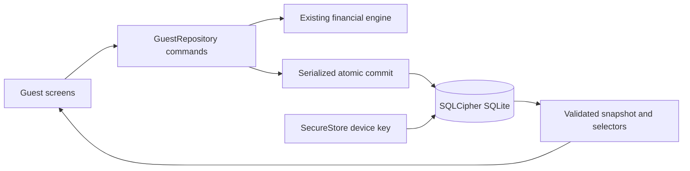

# P1 encrypted guest persistence design

## Boundary and source of truth

The existing `src/domain/ledger.ts`, `money.ts`, `dates.ts` and `installments.ts` are unchanged. Screens submit versioned guest commands to `GuestRepository`; they never write SQL or calculate an alternative balance. Pure feature selectors call the existing domain engine for record balances, cash summaries, current revisions and installment states.

`launch` is the initial INR / two-minor-digit / English locale configuration. Currency, money scale, direction and stable category IDs are explicit in stored records/journal envelopes. Names, local labels and the first launch market do not determine ownership, financial rules or category identity. Other currencies require a deliberate domain/configuration extension; P1 never silently converts or relabels money.

## Native opening sequence

1. Check SecureStore availability. Retrieve and validate the existing 32-byte hex device key.
2. If the key is absent and a database already exists, stop. Do not generate a replacement key, delete a file, or start a blank ledger.
3. For a new database, obtain 32 bytes from native asynchronous secure randomness, persist the key with device-only/unlocked accessibility, and verify readback. The key is not a user password or an application constant.
4. Open a dedicated native SQLite connection. Require a nonempty SQLCipher capability result before setting a key or reading the schema.
5. Apply the validated raw key; perform a keyed schema query and `quick_check`. Wrong keys/corruption stop initialization.
6. Enable foreign keys, a bounded busy timeout, encrypted WAL mode, FULL synchronous commits and SQLCipher memory protection.
7. Apply sequential migrations atomically, validate the stored financial snapshot, then expose the repository to the provider/screens.

Only one keyed connection is owned by this repository. A queue serializes its reads, transactions and closure; no raw connection escapes into UI code. `BEGIN IMMEDIATE`, command validation, inserts/updates, receipt, guest outbox and a validated result snapshot are one commit. Exceptions roll back. If rollback itself fails, the wrapper rejects further work until restart. No automatic error recovery resets financial data.

This intentionally avoids the installed Expo exclusive-transaction helper, which creates a separate connection without carrying a SQLCipher key. All parameterized data statements bind values. The key PRAGMA accepts only locally generated, strictly checked hex.

## Version 1 schema

| Table | Purpose / invariants |
| --- | --- |
| `categories` | 30 defaults: 16 borrowing / 14 lending, exactly 6 Free in each direction. Custom categories retain direction, name, stable ID and archive state. Names are unique per direction; defaults are immutable in P1. |
| `records` | Original ID, explicit direction/currency/scale/category/version and validated metadata JSON. Foreign-key assignment retained when categories archive. |
| `revisions` | Every opening/transaction/correction/void revision, parent identity and per-entry revision number. Primary/unique constraints and an update-blocking trigger protect immutable history. No balance cache is authoritative. |
| `installments` | Separate one-time/monthly entered schedule; creating schedules never posts interest. |
| `record_events` | Creation, financial/lifecycle and category changes, with the full record metadata snapshot at each version. Reopening does not replace identity/history. |
| `settings` | Guest onboarding completion; no OAuth tokens or payment authority. |
| `operations` | Stable operation ID, canonical request, committed result and timestamp. Identical retries return the existing result; different inputs under the same ID conflict. |
| `outbox` | Versioned local guest journal envelope with explicit currency/scale and command/result identity. No cloud transmission; guest data is not auto-imported or treated as an account. |

Schema upgrades use `PRAGMA user_version`. DDL, default seeds and the version marker are in one transaction. Newer schemas, missing migration steps, failed migrations or invalid data are surfaced without resetting or downgrading the database.

## Commands and concurrency

- Create a record with opening snapshot and optional entered schedule in one commit.
- Post advance, component payment, explicitly reviewed interest/fees, reasoned signed adjustment, forgiveness or write-off through the existing engine.
- A reviewed payment may explicitly recognize new interest/fees and apply its cash components atomically. This is not automatic accrual.
- A partial settlement records both cash and a separate borrowing forgiveness/lending write-off, and must clear the recorded balance; neither part can commit alone.
- Corrections require the record version and expected parent revision. Prior revisions remain intact; stale changes fail instead of silently winning.
- Close only at zero; archive changes visibility, not totals; reopen preserves the same ID. Metadata history records prior category/lifecycle state.
- Category creation is capped at 3 customs per direction for Free, including archived/retained Pro categories. Existing custom categories remain assignable after expiry, even above the new-creation limit. All Pro defaults are retained historically; new assignments to paid defaults require Pro, except keeping the record's existing assignment.

A command completes only after its commit acknowledgement. The provider updates its validated snapshot from the result. Forms retain operation IDs across failed retries and capture their initial record/parent version. No optimistic financial balance is invented. An unknown transaction outcome can safely retry the same operation ID.

## Verification boundary

Desktop repository integration tests execute the same migrations/commands against real Node SQLite files, including close/reopen and rollback. Those synthetic fixture files are unencrypted **test infrastructure only**, never a production fallback or user ledger.

Separate security contract tests exercise key loss, capability checks, key-before-schema order, wrong-key/integrity failure, and forbidden web storage. They do not prove native SQLCipher encryption on a device. Native build/device acceptance remains required in [P1_NATIVE_SETUP.md](P1_NATIVE_SETUP.md), with current evidence in [P1_VERIFICATION.md](P1_VERIFICATION.md).

No Supabase, paid entitlement service, ad SDK or Pro calculation engine is implemented in this milestone.