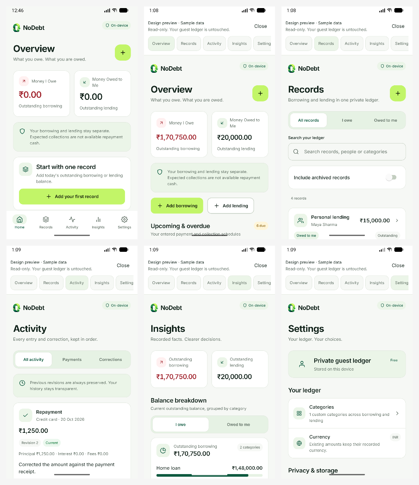
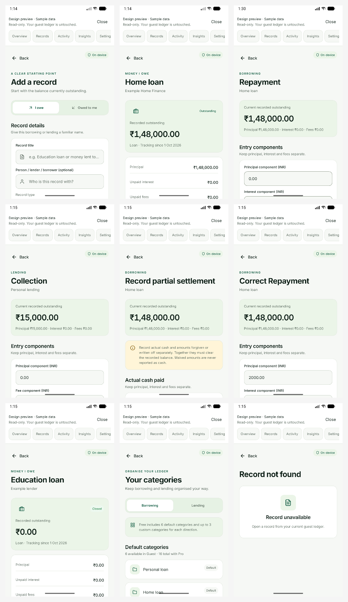
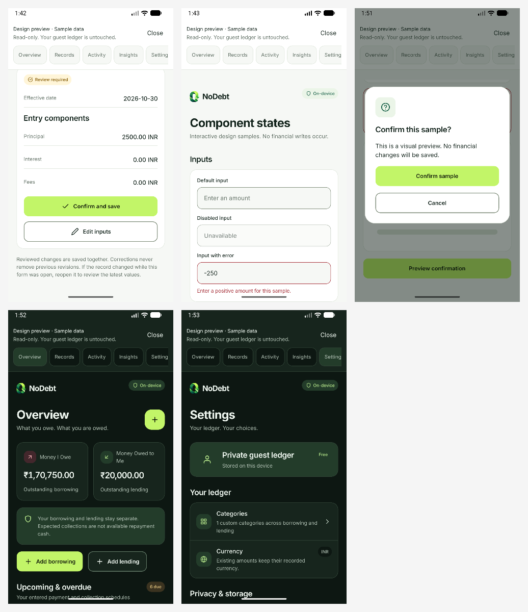

# Native UI validation

30 October 2026 · Android API 37 emulator · 1080 × 1920 pixels, 440 dpi, font scale 1.0 for the completed captures.

Open the [labelled browser gallery](gallery.html), or inspect the contact sheets below. Each screen also has its original PNG and fresh Android accessibility hierarchy XML in this directory. Preview screens deliberately retain the sample-data/read-only banner. The gallery resizes genuine captures without changing their UI content.

## Main pages



Reading order: actual empty Home; sample populated Home; Records; Activity; Insights; Settings. Earlier light captures were taken before the final neutral metric text adjustment; final dark Home shows that adjustment.

## Workflows



Reading order: add record; details; repayment; collection; partial settlement; repayment correction; closed record; categories; missing record. Screens scroll to expose the remainder of their fields, schedules and history. These captures show their initial viewport, rather than asserting every field is simultaneously visible.

## Review, feedback and dark mode



Reading order: repayment review; input/component states; confirmation; dark Home; dark Settings. `payment-form-bottom`, `states-bottom` and their XML files provide additional lower-page evidence. The edited repayment amount is `2500.00 INR`; the financial save control is disabled in the preview. The generic sample confirmation has only local no-op behavior.

## Results and reproducibility

- Checks log (retained locally): TypeScript and lint pass; 69 tests pass, none fail.
- [Contrast](contrast.json): 18 measured semantic pairs pass their respective thresholds.
- [Machine-readable summary](validation-summary.json): capture inventory and remaining checks.
- No sample financial records were persisted. `home-empty.png` shows the actual empty guest ledger. Populated views use the memory-only fixture and reject financial writes.
- No runtime error marker was found in the 20 gallery hierarchies. This smoke check complements visual inspection; it does not prove every financial journey end to end.
- Supplemental tablet/large-text captures could not finish: automatic approval review for emulator capture timed out twice. Native commands had reset emulator dimensions/density and set font scale 1.5 before the capture stopped; a 1.5-scale result is not claimed as verified. iOS and physical-device visual validation were not run.

With the development client open and Metro running, navigate to a catalog link from [the implementation record](../UI_REFINEMENT.md), then capture:

```powershell
powershell.exe -NoProfile -ExecutionPolicy Bypass -File scripts/capture-ui-android.ps1 -Name home-populated -ExpectedText 'What you owe. What you are owed.'
node scripts/build-ui-gallery.cjs
```

`ExpectedText` waits for the intended native screen instead of accepting a stale navigation frame. The script captures only the emulator (`adb -e`). It does not install, uninstall, clear application data, or write financial records.

To restore default emulator display settings after further visual testing:

```powershell
$adb = Join-Path $env:LOCALAPPDATA 'Android\Sdk\platform-tools\adb.exe'
& $adb -e shell wm size reset
& $adb -e shell wm density reset
& $adb -e shell settings put system font_scale 1.0
& $adb -e shell cmd uimode night no
```


Publication note: raw Android hierarchy dumps and build/check logs are retained locally and excluded from Git. Published images in this directory show approved reference artwork, read-only sample data or an empty Guest workspace. Real account captures remain private under the ignored .expo directory.
